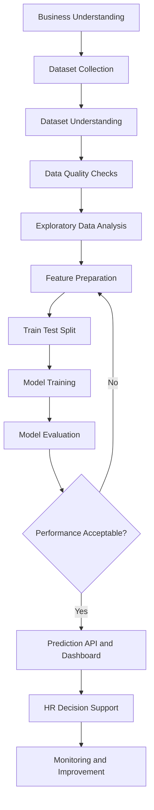

# Employee Attrition Analytics Workflow

## Workflow Diagram

## Workflow Explanation

1. **Business Understanding:** Define the employee attrition problem and project objectives.
2. **Dataset Collection:** Load the employee HR dataset.
3. **Dataset Understanding:** Review the columns, feature types, and target variable.
4. **Data Quality Checks:** Check missing values, duplicates, and data consistency.
5. **Exploratory Data Analysis:** Examine distributions and relationships in the data.
6. **Feature Preparation:** Prepare numerical and categorical data for machine learning.
7. **Train-Test Split:** Separate data for training and evaluation.
8. **Model Training:** Train candidate classification models.
9. **Model Evaluation:** Compare models using appropriate performance metrics.
10. **Prediction API and Dashboard:** Provide local prediction and visualization interfaces.
11. **HR Decision Support:** Use results responsibly alongside human judgment.
12. **Monitoring and Improvement:** Review performance and update the system when appropriate.

**Note:** The diagram represents the intended project workflow. Live IBM Watson cloud deployment and automated cloud monitoring have not been completed.